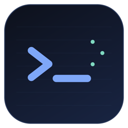

<div align="center">



# NimbusTerm

**A native SSH / SFTP workspace for macOS — tabs, splits, tunnels, keys, monitoring and MobaXterm import.**

No Electron. No Java. One `.app` built with SwiftUI and SwiftTerm.

[](https://github.com/maestro-37/nimbusterm/releases)
[](https://github.com/maestro-37/nimbusterm/stargazers)
[](https://github.com/maestro-37/nimbusterm/forks)
[](https://github.com/maestro-37/nimbusterm/issues)
[](https://github.com/maestro-37/nimbusterm/commits/main)
[](https://github.com/maestro-37/nimbusterm)
[](https://swift.org)
[](LICENSE)

[](#-support-the-project)
[](https://github.com/maestro-37/nimbusterm)

[Website](https://maestro-37.github.io/nimbusterm/) · [Install](#-installation) · [Features](#-features) · [Shortcuts](#-keyboard-shortcuts) · [Build](#-build-from-source) · [Security](#-security) · [FAQ](#-faq) · [Support](#-support-the-project)

</div>

---

NimbusTerm is a native macOS SSH/SFTP terminal and a lightweight alternative to MobaXterm. It keeps the workflow — a session library with folders and tags, tabs and splits, an SFTP browser next to the terminal, tunnels and keys in one place — but is a clean native app on top of the system OpenSSH.

The application code was written from scratch. The only thing it takes from MobaXterm is the **session file format**, so you can import your existing sessions. No MobaXterm code, assets or icons are used.

> **Status:** v1.0, usable every day. See [Limitations](#-limitations) for what is intentionally out of scope.

## ✨ Features

### Terminal
- **SwiftTerm**-based (MIT): truecolor, 256 colors, mouse reporting, clickable links, scrollback, copy/paste.
- Find with `⌘F`, next/previous with `⌘G` / `⇧⌘G`.
- Font and theme picker. Themes: Nimbus, Solarized Dark/Light, Dracula, System — each with its own 16-color ANSI palette.
- Tabs (`⌘T`), drag to reorder (the strip rearranges live while you drag), recursive splits (`⌘D` vertical, `⇧⌘D` horizontal), and a **4 panes** preset. Drop a tab onto a terminal pane to split it there.
- **Broadcast input** (`⇧⌘B`) — type once, send to every pane in the tab.

### Sessions
- Session types: local shell, SSH, SFTP, raw TCP, RDP/VNC (handed to an external client).
- Folders, tags, favorites, search, drag-and-drop into folders, duplicate.
- **Quick Connect** (`⌘K`) and a session library stored as readable JSON.
- Restores tab and split layout on launch. Local shells start immediately; SSH tabs wait for a click, so a restart doesn't open a dozen connections.

### SSH
- Uses the system `ssh`: agent, keys, `~/.ssh/config`, ProxyJump, FIDO keys, compression, keepalive.
- X11 forwarding with `-X` / `-Y` (requires XQuartz).
- Login command and `SetEnv` per session.
- **ControlMaster** socket in `~/.nimbusterm-cm` shared by the terminal, SFTP and monitoring — no repeated handshakes.

### Passwords & keys
- Optional password / passphrase field in the session editor. Stored in the **macOS Keychain**, never in `library.json`.
- Secrets reach `ssh` / `sftp` through an askpass helper, never through `argv`.
- Key manager: lists `~/.ssh`, generates ed25519 keys (passphrase via PTY), copies the public key, runs `ssh-copy-id` from the app.

### SFTP
- Remote directory on the left, built-in editor on the right. Toggle to a local pane for transfers.
- Upload / download, mkdir, rename, delete, chmod, drag between panes.
- Transfer queue with progress and cancel.
- Editor: `⌘S` to save, reload, protection against overwriting someone else's changes, 2 MB limit, binary files open in an external editor.

### Tunnels & monitoring
- Local, remote and dynamic SOCKS tunnels. Autostart, status, live stderr.
- Each tunnel owns its connection and shuts down cleanly.
- Server monitoring over SSH every N seconds: load, RAM, disk, uptime — as a compact status bar strip.

### Import, snippets, logs
- Import `~/.ssh/config` and MobaXterm `.mxtsessions` / `MobaXterm.ini` (SSH, SFTP, RDP, VNC).
- Snippets with `{host}`, `{user}`, `{port}`, `{name}` placeholders.
- Session transcript logging to `~/Documents/NimbusTerm/Logs` (per session or globally).

## 📥 Installation

### DMG (recommended)

1. Download `NimbusTerm-1.0.dmg` from [**Releases**](https://github.com/maestro-37/nimbusterm/releases/latest).
2. Open the image and drag **NimbusTerm** into **Applications**.
3. Launch it.

### PKG

`NimbusTerm-1.0.pkg` installs into `/Applications` through the standard Installer wizard and asks for an administrator password.

### First launch and Gatekeeper

The app is **ad-hoc signed**, so macOS may warn about an unidentified developer. Either:

- right-click the app → **Open** → **Open**, or
- for the PKG: **System Settings → Privacy & Security → Open Anyway**, or
- remove the quarantine flag:

```bash
xattr -dr com.apple.quarantine /Applications/NimbusTerm.app
```

On first run, create a session with `⇧⌘N`, or import your existing SSH config / MobaXterm sessions with `⇧⌘I`.

The interface is available in **English and Russian**. It follows the macOS language; switch it in **Settings → Language** (restart required, there is a "Restart now" button).

## ⌨️ Keyboard shortcuts

| Shortcut | Action |
|---|---|
| `⌘T` | New local terminal tab |
| `⇧⌘N` | New session |
| `⌘K` | Quick Connect |
| `⌘W` | Close tab |
| `⌘D` | Split vertically |
| `⇧⌘D` | Split horizontally |
| `⇧⌘W` | Close pane |
| `⇧⌘B` | Broadcast input to all panes |
| `⌘F` | Find in terminal |
| `⌘G` / `⇧⌘G` | Find next / previous |
| `⇧⌘F` | SFTP for the active session |
| `⇧⌘I` | Import sessions |
| `⌃⌘S` | Show/hide sidebar |
| `⌘,` | Settings |

## 🧱 Requirements

- **macOS 14+** (developed and tested on macOS 27 / Apple Silicon).
- **Swift 6.4 Command Line Tools.** Xcode is not required; the app builds with `swift build`. (`@State` from the SDK 27 is a macro whose plugin ships only with Xcode, so the project uses an equivalent `@LocalState` wrapper around `StateObject`.)
- **SwiftTerm 1.99.3** — fetched automatically by SwiftPM.
- Optional: **XQuartz** for X11 forwarding, **Windows App** (Microsoft Remote Desktop) for RDP, **Screen Sharing** for VNC.

## 🔨 Build from source

```bash
git clone https://github.com/maestro-37/nimbusterm.git
cd nimbusterm

./scripts/build-app.sh          # dist/NimbusTerm.app + dist/NimbusTerm.zip
open dist/NimbusTerm.app
```

Or run straight from sources:

```bash
swift run NimbusTerm
```

### Build the installers

```bash
./scripts/make-installer.sh
```

This produces in `dist/`:

- `NimbusTerm-1.0.dmg` — drag-and-drop image with a background, slots for the app and `Applications`, and a volume icon. Requires [`create-dmg`](https://github.com/create-dmg/create-dmg) (`brew install create-dmg`); without it the script falls back to a plain DMG with the app and an Applications link.
- `NimbusTerm-1.0.pkg` — Installer.app wizard with welcome, background and summary; built with the system `pkgbuild` / `productbuild`.
- `SHA256SUMS.txt` — checksums.

## 🔄 Importing from MobaXterm

1. In MobaXterm: right-click **User sessions** → **Export sessions to file**.
2. In NimbusTerm: toolbar → **Import** → **MobaXterm** → pick the `.mxtsessions` file.
3. A **MobaXterm** folder is created with the original subfolder structure.
4. **Passwords are not imported.** Enter them once in the session editor and they go to the Keychain. Encrypted MobaXterm passwords are not decrypted.

`~/.ssh/config` is imported into an **SSH config** folder: `Host`, `HostName`, `User`, `Port`, `IdentityFile`, `ProxyJump`. `Include` and wildcard hosts are skipped.

## 🧪 Testing

Core self-test (parsers, split tree, SSH argument building, SFTP listing, corrupted library, monitoring parser — **70 checks**):

```bash
swift run NimbusCoreSelfTest
```

Application self-test (Keychain, askpass, PTY, `ssh-keygen`):

```bash
./.build/debug/NimbusTerm --self-test
```

Full SFTP / tunnel checks need a test SSH server:

```bash
# 1. start the test server (paramiko) in a separate terminal
./scripts/test-ssh-server.sh 2222 /tmp/nimbusterm-sftp

# 2. run the checks
NIMBUSTERM_SFTP_PORT=2222 ./.build/debug/NimbusTerm --self-test --self-test-sftp
NIMBUSTERM_TUNNEL_PORT=18082 ./.build/debug/NimbusTerm --self-test --self-test-tunnel
```

`--self-test-sftp` exercises `pwd`, upload, list, download, delete and `ssh exec`.
`--self-test-tunnel` opens a `-L` tunnel, probes the port with `nc` and stops the tunnel cleanly.

## 🔐 Security

- Passwords and passphrases live **only in the Keychain** (`com.maestro37.nimbusterm`).
- `library.json` contains **no secrets**.
- The askpass helper file is `0600` in a private directory and is deleted right after the process exits.
- `ssh-keygen` / `ssh-copy-id` receive secrets through a PTY, not `argv`.
- Non-interactive channels use `StrictHostKeyChecking=accept-new` (TOFU). The terminal with no stored password asks for the host key the normal way. If a password is stored, the app asks you to confirm TOFU once for that host; afterwards the terminal uses `accept-new` + askpass. A changed host key is still an error, never silent trust.
- **Touch ID** (`LocalAuthentication`) is a **gate before reading the Keychain**, not a replacement for it. The fingerprint is requested once per launch, then the secret is cached in memory.
- Keychain items are bound to the code signature of the build that wrote them. On launch the app compares its own build stamp and **drops items written by another build** instead of showing the "enter the login keychain password" dialog: you are asked for the password once and it is saved again. An installed build never changes, so after that it is Touch ID only.
- Logs can contain secrets if they were printed to the terminal — that's a warning, not a bug.
- Found a vulnerability? Report it privately — see [`SECURITY.md`](SECURITY.md).

## ⚠️ Limitations

- **RDP/VNC** open in an external client (Windows App / Screen Sharing). There is no built-in RDP stack; that would be a separate multi-month project.
- **No built-in X server.** XQuartz is required; the app checks for `/opt/X11/bin/xset` and warns if it is missing.
- No FTP/FTPS, serial, ZMODEM or cloud sync.
- ssh config `Include` is not expanded; MobaXterm `LocalForward` is not converted into a tunnel automatically — create the tunnel manually.
- A tab that already has several panes can be reordered but not dropped into another tab (drag a single-pane tab instead).
- The key generator does not store the passphrase itself: set it in the session editor that uses the key, and it goes to the Keychain.
- Logs contain raw host output timestamped per output chunk, not per line.
- In password mode, SFTP errors are detected from `sftp` output text; with a key/agent the real exit code is used.
- SFTP listing understands both date formats (`Nov 20` and `20 Nov`), but filenames containing newlines are not supported.
- Upload progress is an indicator without a percentage: `sftp` does not report bytes sent.
- The app is **not sandboxed**: it needs access to `~/.ssh`, to arbitrary files and to launching `ssh` / `sftp`.

## 📁 Project structure

```
Sources/NimbusCore/         models, store, SSH arguments, parsers, Keychain, PTY-agnostic logic
Sources/NimbusTerm/         SwiftUI/AppKit UI, terminal, SFTP, tunnels, keys, monitoring
Tests/NimbusCoreSelfTest/   assert-based core self-test
scripts/build-app.sh        builds .app + zip
scripts/make-installer.sh   builds DMG + PKG + checksums
Resources/                  Info.plist, icon, localizations, installer assets
```

## ❓ FAQ

<details>
<summary><b>macOS says the app is damaged or from an unidentified developer.</b></summary>

The app is ad-hoc signed. Right-click → **Open**, or run `xattr -dr com.apple.quarantine /Applications/NimbusTerm.app`.
</details>

<details>
<summary><b>My passwords were not imported from MobaXterm.</b></summary>

By design. MobaXterm stores them encrypted in a format NimbusTerm does not decrypt. Enter each password once in the session editor; it is saved to the Keychain.
</details>

<details>
<summary><b>X11 forwarding does not work.</b></summary>

Install [XQuartz](https://www.xquartz.org) and log in again. NimbusTerm checks for `/opt/X11/bin/xset` and shows a warning if XQuartz is missing.
</details>

<details>
<summary><b>Why does RDP open another app?</b></summary>

A native RDP client is out of scope for v1. NimbusTerm opens `rdp://` in Windows App / Microsoft Remote Desktop and `vnc://` in Screen Sharing.
</details>

<details>
<summary><b>Where are sessions and logs stored?</b></summary>

The session library is a JSON file under Application Support. Logs go to `~/Documents/NimbusTerm/Logs`. Passwords are only in the Keychain.
</details>

## 🤝 Contributing

Issues and pull requests are welcome. Before opening a PR:

```bash
swift build
swift run NimbusCoreSelfTest
```

Please keep the code native (SwiftUI/AppKit, system OpenSSH) and avoid adding dependencies for things the platform already does.

## 💛 Support the project

If NimbusTerm saves you time, the cheapest way to say thanks is a **star** — it helps other people find the project.

[](https://github.com/maestro-37/nimbusterm)

### Crypto

One EVM address covers **Ethereum, BNB Chain, Polygon and Morph**:

```
0xBFdd63E4EB15c6445aD9593Bfd4f4be52c6D9A08
```

**TRON (TRC-20)**

```
TPAewzi6PNaZtEx9eHMbogij7KvGj4Rdo2
```

**Solana (SPL)**

```
AVMm6Qaa8NmrmcEAMSWHoF9p9Z2JxhF2xHavUozSQfXq
```

Send only on the networks listed above — a transfer on the wrong chain cannot be recovered.

## 📄 License & attribution

- The application code is released under the **MIT License** — see [`LICENSE`](LICENSE). Copyright (c) 2026 maestro37.
- [SwiftTerm](https://github.com/migueldeicaza/SwiftTerm) is MIT licensed.
- Importing `.mxtsessions` is **format compatibility**, not copying MobaXterm code or assets.
- **MobaXterm** is a trademark of Mobatek. This project is **not affiliated with Mobatek**.
- The `Crack/` files from the original distribution are not used.

---

<div align="center">
<sub>Built with SwiftUI, SwiftTerm and the system OpenSSH. Made for macOS.</sub>
</div>
